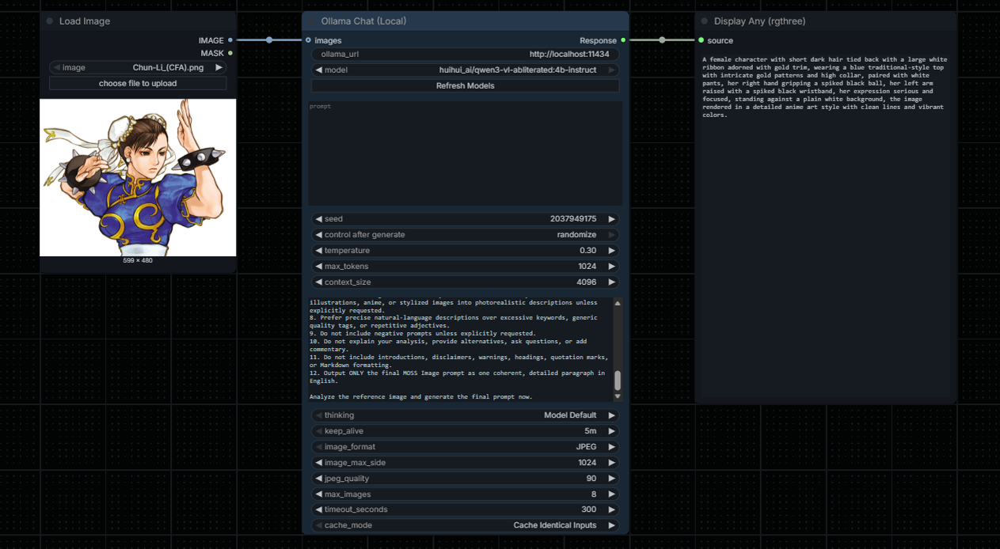

<div align="center">

# ComfyUI Ollama Bridge
**Custom node for Ollama integration.**


</div>

A lightweight, **one-node** ComfyUI extension that sends prompts and optional images directly to a local Ollama model and outputs a regular `STRING` named **Response**.

No API keys, cloud account, or extra Python packages are required beyond the dependencies already used by a standard ComfyUI installation (`aiohttp`, `Pillow`, and PyTorch).

## Installation

### Git
Open a terminal inside the ComfyUI `custom_nodes` directory and clone the repository:

```bash
cd ComfyUI/custom_nodes
git clone https://github.com/VictorDmAlves/comfyui-ollama-bridge
```

### ZIP
1. Download the repository as a ZIP file.
2. Extract it into `ComfyUI/custom_nodes/`.
3. Make sure the final structure is not nested twice.

Correct:

```text
ComfyUI/
└── custom_nodes/
    └── comfyui-ollama-bridge/
        ├── __init__.py
		├── node.py
		├── ollama.py
        ├── __pycache__/
		├── tests/
		└── web/
```

## Utilization
1. Make sure [Ollama](https://ollama.com/) is installed and running on the computer running the **ComfyUI backend**.
2. Download a model, for example `ollama pull gemma3:4b` (choose a model that supports images if you want vision input).
3. Add **Ollama > Local LLM > Ollama Chat (Local)** node.
4. The default URL is `http://localhost:11434`. Click **Refresh Models** to update the dropdown after new models are downloaded.
5. Connect **Response** to any ComfyUI input accepting `STRING` (such as a text-display node or a string-capable CLIP text-encode input).

## Text-to-text
```
Ollama Chat (Local)  -- Response (STRING) --> text display / CLIP Text Encode
```

The model receives the exact text in **Prompt**, preceded by **System Prompt** when set.

## Image-to-text
```
Load Image -- IMAGE --> images [Ollama Chat (Local)] -- Response --> text display
```

Use a **vision-capable Ollama model**. A text-only Ollama model cannot understand attached images. Leave the prompt blank to ask the model to describe the images, or provide your own instructions.

## Multiple images
The `images` socket accepts:
- One `Load Image` node (single-image batch).
- A batch containing multiple images.
- A ComfyUI `IMAGE` list produced by a list-capable upstream node, including lists of batches.

**One Ollama chat request** contains all attached images together, so you can ask the model to compare them. This extension does not automatically create a multi-input fan-in socket: to connect several independent `Load Image` nodes, first combine them with a batch/list node.

## Controls
The main view shows URL, model, prompt, seed, temperature, Max Tokens, and Cache Mode. Additional settings are marked **Advanced** on frontends that support this feature.

| Control | Purpose |
|---|---|
| Ollama URL | `http://localhost:11434` by default; address is resolved on the ComfyUI backend machine. |
| Model | Dropdown of installed Ollama models. |
| Refresh Models | Update model choices immediately; no ComfyUI restart required. |
| Prompt | The user message sent to Ollama. |
| Seed | Sent as Ollama `options.seed`. Supports ComfyUI's built-in `control_after_generate` modes: fixed, increment, decrement, randomize. |
| Temperature | Sampling randomness. |
| Max Tokens | Ollama `num_predict` limit. |
| Context Size | Ollama `num_ctx` (higher values use more memory). |
| System Prompt | Optional independent system instruction. |
| Thinking | Use model default, explicitly enable, or explicitly disable, for supported models. |
| Keep Alive | `5m`, `30m`, `1h`, `0` (unload), or `-1` (keep loaded). |
| Image Format | JPEG for smaller requests or PNG for lossless image content. |
| Image Max Side | Resize images before sending; preserves aspect ratio. |
| JPEG Quality | Compression quality (JPEG only). |
| Max Images | Refuse unexpectedly large batches, rather than silently dropping images. |
| Timeout Seconds | Wait time for model generation; default 300 seconds. |
| Cache Mode | Cache identical inputs or call Ollama every time a queued workflow executes this node. |
| images | Optional ComfyUI `IMAGE` input, with batch/list support. |

## Speed tips
- **Cache Identical Inputs** is the default, so unchanged workflows do not repeat costly Ollama calls. Use **Always Run** if you want a new response each time you queue a graph.
- Keep **Keep Alive** at `5m` or longer to avoid reloading the model on repeated requests.
- Choose **JPEG** and lower **Image Max Side** for faster encoding and transfer. Choose PNG for screenshots with small text.
- Lower **Max Tokens** for short captions or prompt suggestions.
- Setting a seed increases repeatability but does not guarantee bit-for-bit identical output across Ollama/model/hardware versions.

## Troubleshooting
- **Refresh Models fails**: Check `ollama list`, make sure Ollama is running and available at the given URL, and look in the browser developer console for the error.
- **Model not found**: Run `ollama pull MODEL_NAME`, then click Refresh Models.
- **Model cannot process images**: Choose a vision-capable model. The node does not convert text-only models to vision models.
- **Output looks unchanged**: Set Cache Mode to **Always Run**, vary the seed, or modify the prompt. ComfyUI caches unchanged inputs.
- **ComfyUI in Docker/WSL**: `localhost` refers to the ComfyUI backend/container, not necessarily your Windows host. To access Ollama on a different trusted host, configure its network listener carefully and set `OLLAMA_BRIDGE_ALLOW_REMOTE=1` in the ComfyUI backend environment. This is opt-in for security; it must be configured **before** starting ComfyUI.
- **The Refresh Models button doesn't appear**: Update ComfyUI/frontend, ensure the `web/` directory is installed, and hard-reload the page.

## Network safety
This extension communicates directly from the **ComfyUI Python backend** to Ollama using `/api/tags` and `/api/chat`. By default, it permits only `localhost`, `127.0.0.1`, and `::1`, and blocks HTTP redirects. This prevents the refresh endpoint from becoming a general-purpose server-side URL fetcher.

For Ollama running on a *trusted* different host, set `OLLAMA_BRIDGE_ALLOW_REMOTE=1`; do not enable this if you expose ComfyUI to untrusted users. Ollama's default local API is unauthenticated. Do not publicly expose Ollama or ComfyUI without appropriate access controls.

## Architecture
- `node.py`: one ComfyUI custom node using the compatible V1 node interface.
- `ollama.py`: local HTTP client, small model-list cache, image conversion/encoding.
- `__init__.py`: ComfyUI registration and safe route for fresh dropdown options.
- `web/ollama_bridge.js`: refresh button, dynamic model choices, node coloring.
- `tests/`: HTTP and image tests using only the standard library and ComfyUI dependencies.

## Contributing
If you encounter a bug or have an idea for improvement, feel free to open a GitHub Issue with relevant details, logs, and steps to reproduce the problem.

## Acknowledgements
This project utilizes Ollama, an open-source platform that enables running large language models and vision-language models locally.

Special thanks to the Ollama development team and community for making local AI inference accessible and providing the API that enables this integration.

## License
See [LICENSE](LICENSE).